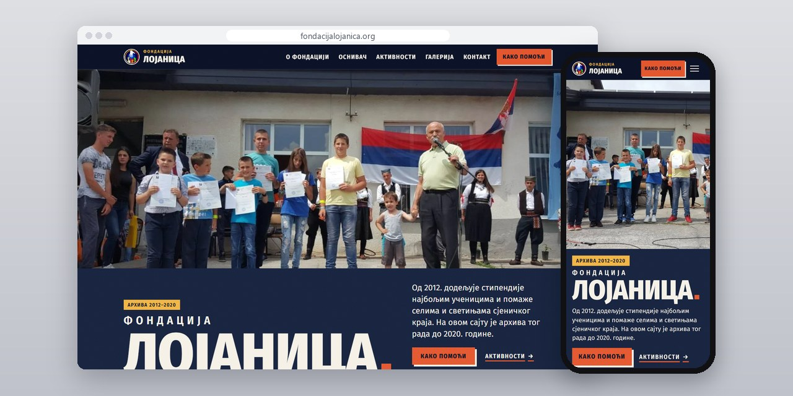
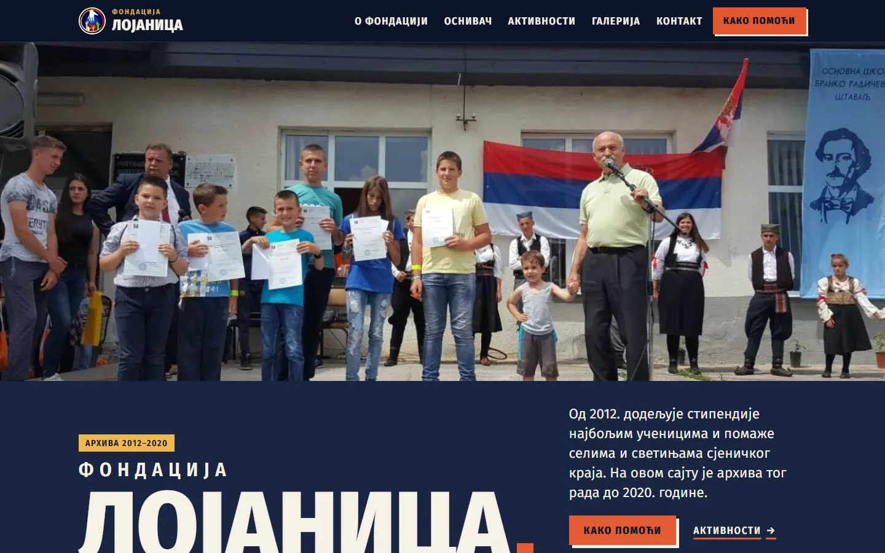
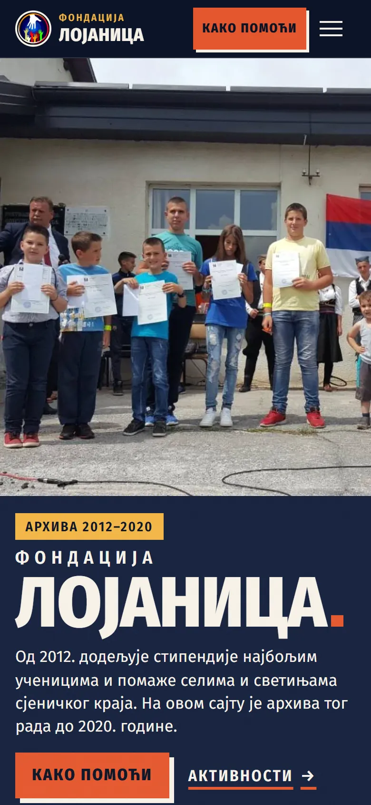
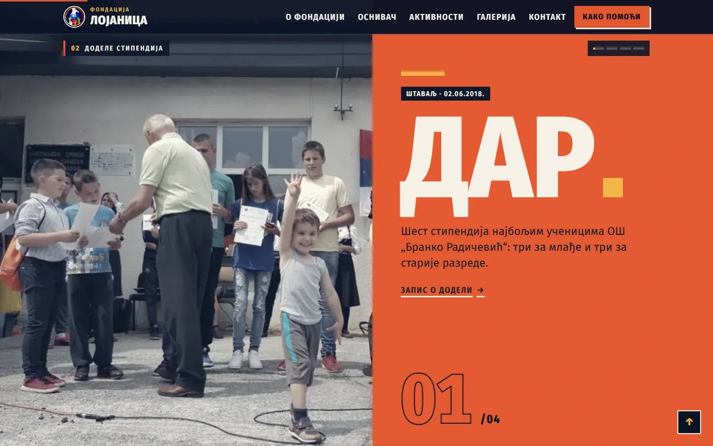
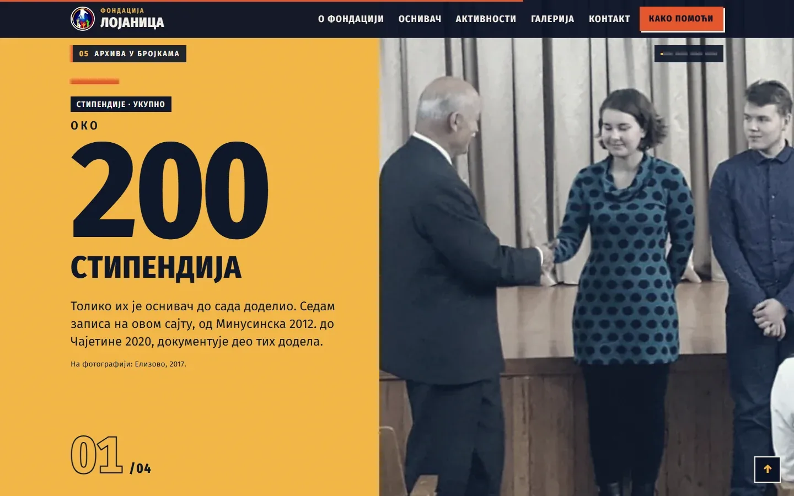

# Fondacija Lojanica

A redesign of the site of a charitable foundation from the Sjenica region, with a home page in six scenes and an archive of its work from 2012 to 2020.

**[fondacijalojanica.org](https://fondacijalojanica.org/)** · [Case study](https://svilenkovic.com/portfolio/fondacija-lojanica) · [Srpski](README.sr.md)

> [!NOTE]
> Client project. The source code belongs to the client and stays in a private repository. This page describes what I built and how.

<table>
  <tr><td><b>Client</b></td><td>Fondacija Lojanica</td></tr>
  <tr><td><b>Industry</b></td><td>Scholarships for gifted students and help for villages</td></tr>
  <tr><td><b>Location</b></td><td>Belgrade and Sjenica, Serbia</td></tr>
  <tr><td><b>Type</b></td><td>Multi-page website with an activity archive</td></tr>
  <tr><td><b>My role</b></td><td>Redesign, development, migration, SEO and hosting</td></tr>
  <tr><td><b>Stack</b></td><td>PHP 8.5, SQLite, nginx, JSON-LD</td></tr>
</table>

## About the project

Fondacija Lojanica has awarded scholarships to top students since 2012 and helped the villages, a church and a mosque in the Sjenica region, with scholarships also given in Bosnia and Herzegovina, Russia and Čajetina. The site keeps the record of that work up to 2020. The new design puts the faces of the students and villagers who received help first and marks the site clearly as an archive, so that nobody thinks a call for applications is open.

The home page is a full-screen poster that changes with scrolling, in six scenes. Each step has one large word, a place and a date, a short text and a link to the record of that activity, and the photo moves from two tones to full color. In the numbers scene the figures count up: about 200 scholarships awarded by the founder, 400 seedlings for 80 households, 150 runners at the first Sjenica marathon and 20 documented activities, with a note that the scholarship records on the site cover only part of those awards. A button in the footer stops the animations.

## What I built

- An archive of 20 activity records from 2012 to 2020, each with its own address and photos
- A gallery of 11 albums arranged by activity, each leading to the record of that event
- Pages for the founding message, the founder's biography, the statute, the 2012 programs, documents and how to help
- Content moved from the old Drupal site into SQLite, with eight old file addresses redirected in a single 301 hop
- Fira Sans split into Cyrillic and Latin parts, so the browser downloads only what a page uses
- Scenes that stop pinning with reduced motion or without JavaScript, and analytics only after consent

## Results

| | Performance | Accessibility | Best practices | SEO |
| :-- | :-: | :-: | :-: | :-: |
| Mobile | 99 | 100 | 100 | 100 |
| Desktop | 100 | 100 | 100 | 100 |

PageSpeed Insights, lab test of the live site, November 2026. Security headers: 6 of 6. HTML validator: no errors. axe accessibility check: no violations. Structured data: `BreadcrumbList`, `Organization`, `Person`.

## Screenshots

<table>
  <tr>
    <td width="68%" valign="top"></td>
    <td width="32%" valign="top"></td>
  </tr>
</table>

Scholarship awards: one large word per step, a place, a date and a link to the record

The archive in numbers: about 200 scholarships, with a note that the site documents only part of the awards

---

Built by [D. Svilenković](https://svilenkovic.com).
