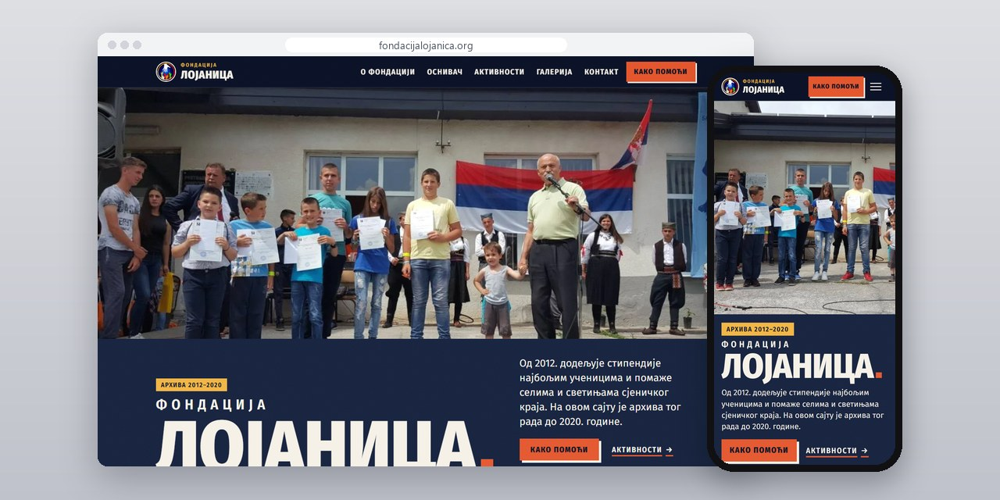
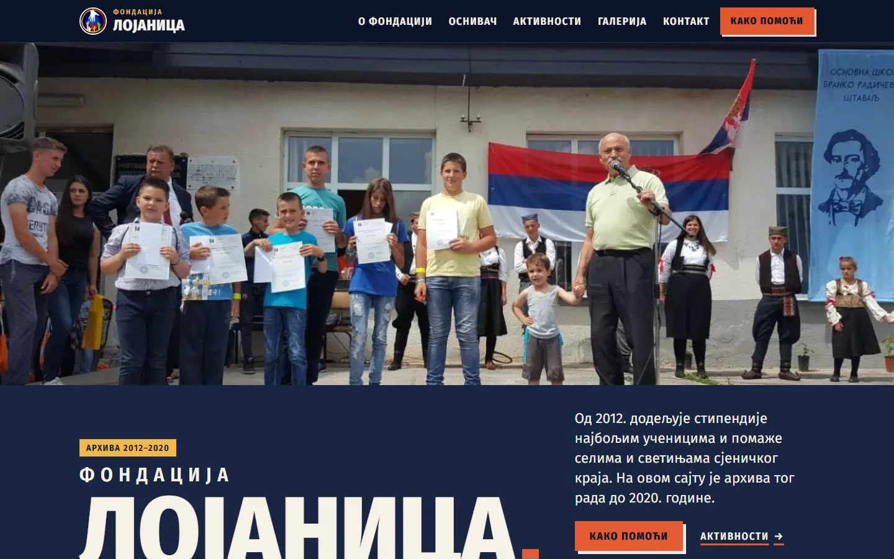
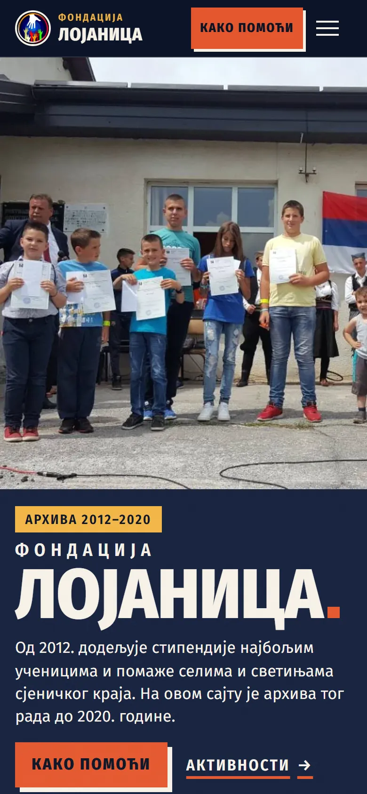
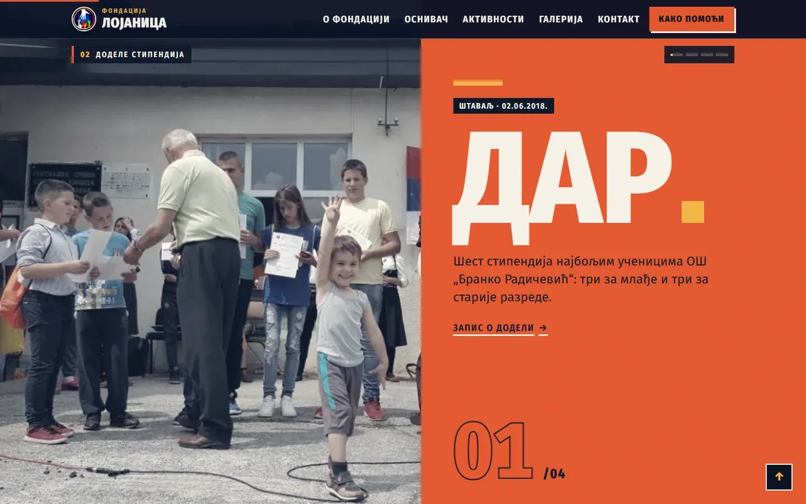
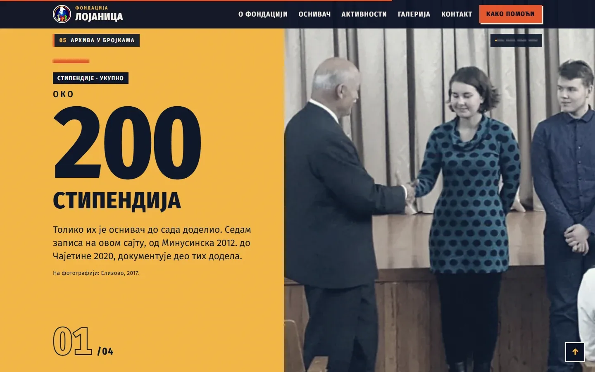

# Fondacija Lojanica

Nov izgled sajta dobrotvorne fondacije iz sjeničkog kraja, sa početnom u šest scena i arhivom rada od 2012. do 2020.

**[fondacijalojanica.org](https://fondacijalojanica.org/)** · [Studija slučaja](https://svilenkovic.rs/radovi/fondacija-lojanica) · [English](README.md)

> [!NOTE]
> Klijentski projekat. Izvorni kod pripada klijentu i čuva se u privatnom repozitorijumu. Ova stranica opisuje šta sam uradio i kako.

<table>
  <tr><td><b>Klijent</b></td><td>Fondacija Lojanica</td></tr>
  <tr><td><b>Delatnost</b></td><td>Stipendije za darovite učenike i pomoć selima</td></tr>
  <tr><td><b>Lokacija</b></td><td>Beograd i Sjenica</td></tr>
  <tr><td><b>Vrsta</b></td><td>Sajt sa više strana i arhivom aktivnosti</td></tr>
  <tr><td><b>Moj deo posla</b></td><td>Redizajn, izrada, selidba, SEO i hosting</td></tr>
  <tr><td><b>Tehnologije</b></td><td>PHP 8.5, SQLite, nginx, JSON-LD</td></tr>
</table>

## O projektu

Fondacija Lojanica od 2012. dodeljuje stipendije najboljim učenicima i pomaže selima i svetinjama sjeničkog kraja, a stipendije je dodeljivala i u Bosni i Hercegovini, Rusiji i Čajetini. Sajt čuva zapise o tom radu do 2020. godine. U novom izgledu prvi plan dobijaju lica učenika i meštana kojima je pomoć stigla, a sajt je jasno označen kao arhiva, da niko ne pomisli da je konkurs otvoren.

Početna je plakat preko celog ekrana koji se menja skrolom, u šest scena. Svaki korak ima jednu krupnu reč, mesto i datum, kratak tekst i vezu na zapis o toj aktivnosti, a fotografija prelazi iz dvobojne u punu boju. U sceni sa brojkama broj se odbrojava do svoje vrednosti: oko 200 stipendija koje je osnivač dodelio, 400 sadnica za 80 domaćinstava, 150 učesnika prvog Sjeničkog maratona i 20 dokumentovanih aktivnosti, uz napomenu da zapisi na sajtu dokumentuju samo deo tih dodela. U podnožju je dugme koje zaustavlja animacije.

## Šta sam uradio

- Arhiva od 20 zapisa aktivnosti od 2012. do 2020, svaki sa svojom adresom i fotografijama
- Galerija od 11 albuma složenih po aktivnostima, svaki vodi na zapis o tom događaju
- Strane za osnivačku poruku, biografiju osnivača, statut, programe iz 2012, dokumente i uputstvo kako pomoći
- Sadržaj prenet sa starog Drupal sajta u SQLite bazu, uz osam starih adresa fajlova preusmerenih jednim skokom (301)
- Fira Sans podeljen na ćirilični i latinični deo, pa pregledač preuzima samo ono što strana koristi
- Scene koje se ne kače uz smanjen pokret ili bez JavaScript-a i analitika samo uz pristanak

## Merenja

| | Performanse | Pristupačnost | Dobre prakse | SEO |
| :-- | :-: | :-: | :-: | :-: |
| Telefon | 99 | 100 | 100 | 100 |
| Desktop | 100 | 100 | 100 | 100 |

PageSpeed Insights, laboratorijsko merenje živog sajta, novembar 2026. Sigurnosna zaglavlja: 6 od 6. HTML validator: bez grešaka. axe provera pristupačnosti: bez prekršaja. Strukturisani podaci: `BreadcrumbList`, `Organization`, `Person`.

## Snimci ekrana

<table>
  <tr>
    <td width="68%" valign="top"></td>
    <td width="32%" valign="top"></td>
  </tr>
</table>

Dodele stipendija: jedna krupna reč po koraku, mesto, datum i veza na zapis

Arhiva u brojkama: oko 200 stipendija, uz napomenu da sajt dokumentuje deo dodela

---

Izrada: [D. Svilenković](https://svilenkovic.rs).
